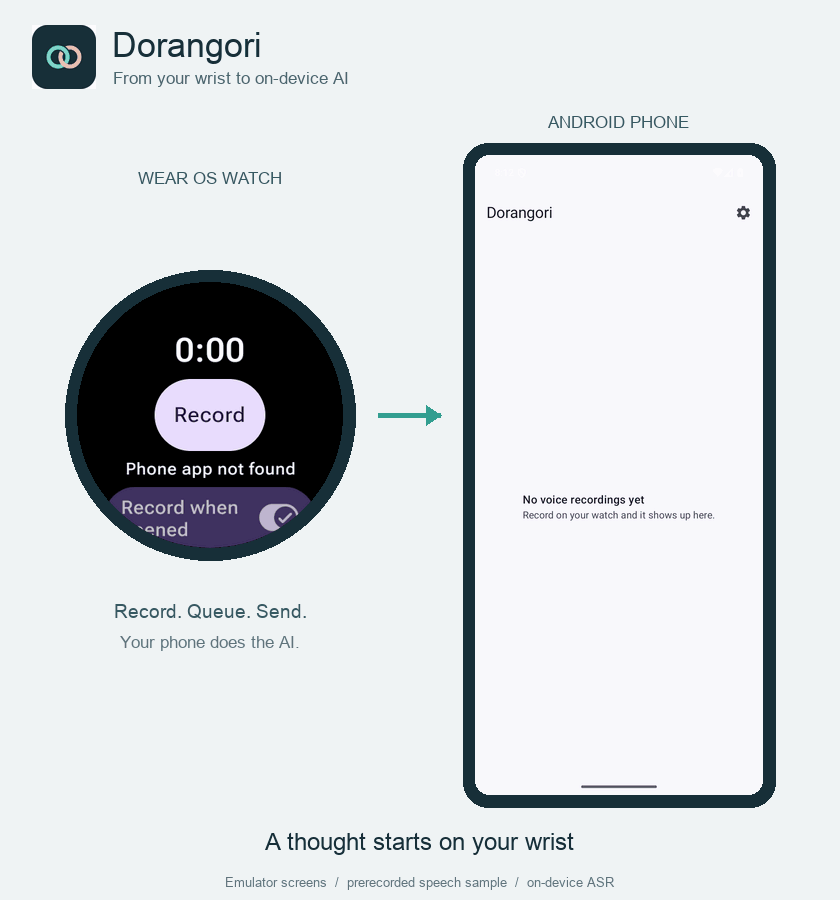

# 도란고리 / Dorangori

[English](README.md) | **한국어**

손목에서 떠오른 생각을 잡고, 폰에서 쓸모 있게 풀어 줍니다. **도란고리**는 Wear OS와 Android를 잇는 온디바이스 AI 앱입니다. 워치에서 녹음하면 [온돌샘](https://github.com/sonanjip/ondolsaem)이 폰 안에서 텍스트로 바꾸고, 복사하거나 [말벗다리](https://github.com/sonanjip/malbotdari)에 묻거나 음성과 텍스트를 함께 [조각보](https://github.com/sonanjip/jogakbo)에 저장할 수 있습니다.

<p></p>

*실제 워치·폰 에뮬레이터 화면을 나란히 구성했습니다. 에뮬레이터 마이크 대신 미리 녹음한 음성 샘플을 사용하며, 전송·음성 인식·노트 저장은 앱에서 실제로 실행합니다.*

## 기능

| 기능 | 동작 |
|---|---|
| 워치에서 녹음 | 화면 버튼으로 시작·정지합니다. 워치 설정에서 도란고리 실행을 지정한 물리 버튼으로 앱을 열 수도 있습니다. 홈·뒤로 버튼을 가로채지 않습니다. |
| 연결되면 전송 | 폰과 연결되지 않으면 워치에 보관했다가 재연결 시 전송합니다. 폰의 수신 확인 후 워치 원본을 지웁니다. |
| 온디바이스 변환 | 폰의 온돌샘이 음성을 인식합니다. 바로·정해진 시각·한가할 때·요청할 때 중 선택합니다. |
| 인식 언어 | 자동 감지·기기 언어·한국어·영어·일본어·중국어·광둥어. 앱 표시 언어와 별개입니다. |
| 결과 활용 | 복사, 말벗다리 질문 초안 열기(자동 전송 아님), 음성·텍스트·시간 자막을 조각보의 한 노트로 저장합니다. |
| 녹음 관리 | 목록과 텍스트 미리보기, 재생, 상세 작업, 재시도·다시 변환, 다중 선택 삭제, 7·30·90일 후 자동 삭제를 지원합니다. |
| 한국어·영어 | 폰·워치 UI 모두 지원합니다. 지원하는 폰에서는 Android 설정에서 앱 표시 언어를 따로 선택할 수 있습니다. |

핵심 흐름은 페어링된 에뮬레이터에서 검증했고, 갤럭시 폰·워치에서도 기본 동작을 확인했습니다. 물리 버튼 지정과 삼성의 백그라운드 정책은 기기에 따라 다릅니다. [검증 기록과 한계](docs/roadmap.md)를 참고하세요.

## 설치

[도란고리 Releases](https://github.com/sonanjip/dorangori/releases)에서 APK 두 개를 받습니다.

- **Dorangori-Phone-0.2.0.apk** — Google Play 서비스가 있는 Android 10 이상 폰.
- **Dorangori-Wear-0.2.0.apk** — 해당 폰과 페어링된 Wear OS 3 이상 워치. 두 도란고리 APK의 서명 키가 같아야 합니다.

폰에 [온돌샘 0.9.0 이상](https://github.com/sonanjip/ondolsaem/releases)을 설치하고 모델 탭에서 SenseVoice를 받으세요. 음성·텍스트 노트 저장에는 [조각보 0.7.0 이상](https://github.com/sonanjip/jogakbo/releases), 질문에는 [말벗다리](https://github.com/sonanjip/malbotdari/releases)를 추가로 설치합니다. 공개 릴리스는 공용 키로 서명되어 앱 사이의 로컬 서비스 연결에 별도 승인이 필요 없습니다.

폰 APK는 파일 탐색 앱에서 받아 열어 설치하면 됩니다. 워치는 개발자 옵션 → ADB 디버깅·무선 디버깅을 켜고, 같은 네트워크의 컴퓨터에서 Wi-Fi ADB로 설치합니다.

```bash
adb pair WATCH_IP:PAIRING_PORT    # 새 기기 페어링 화면: 여섯 자리 코드 입력
adb connect WATCH_IP:CONNECT_PORT # 무선 디버깅 메인 화면: 위와 다른 포트
adb -s WATCH_IP:CONNECT_PORT install -r Dorangori-Wear-0.2.0.apk
```

페어링이 끝날 때까지 코드 화면을 열어 두세요. 실제 삼성 워치와 폰은 기존 **Galaxy Wearable**로 페어링합니다. 개발 문서의 Pixel Watch 컴패니언은 에뮬레이터용입니다. 설치 후 무선 디버깅을 꺼도 일반 녹음 전송에는 영향이 없습니다. 로컬 디버그 빌드와 릴리스의 서명이 다르면 기존 빌드를 먼저 삭제해야 할 수 있으니, 필요한 녹음은 그 전에 보관·내보내기 하세요.

## 이름의 뜻

**도란고리 (Dorangori)**는 정답게 작은 목소리로 이야기를 나누는 **도란도란**의 **도란**과, 서로를 이어 주는 **고리**를 합친 이름입니다. 손목에 건넨 한마디가 고리를 타고 폰의 AI 도구로 이어집니다. 청록색·살구색 두 고리가 엮인 아이콘도 워치와 폰이 함께 일하는 모습을 나타냅니다.

녹음기에만 머무르지 않도록 이름도 넓게 잡았습니다. 앞으로 폰·워치 페어가 필요한 다른 온디바이스 AI 기능도 도란고리에서 이어 나갈 수 있습니다. 온돌샘·눈소리·조각보·말벗다리와 함께 [손안집](https://github.com/sonanjip)에 속합니다.

[사용 안내](docs/user-guide.md) · [개발·데모 촬영](docs/development.md) · [구조](docs/architecture.md) · [개인정보](docs/privacy.md) · [로드맵](docs/roadmap.md)

Apache-2.0. [LICENSE](LICENSE), [서드파티 고지](THIRD_PARTY_NOTICES.md)를 참고하세요.
