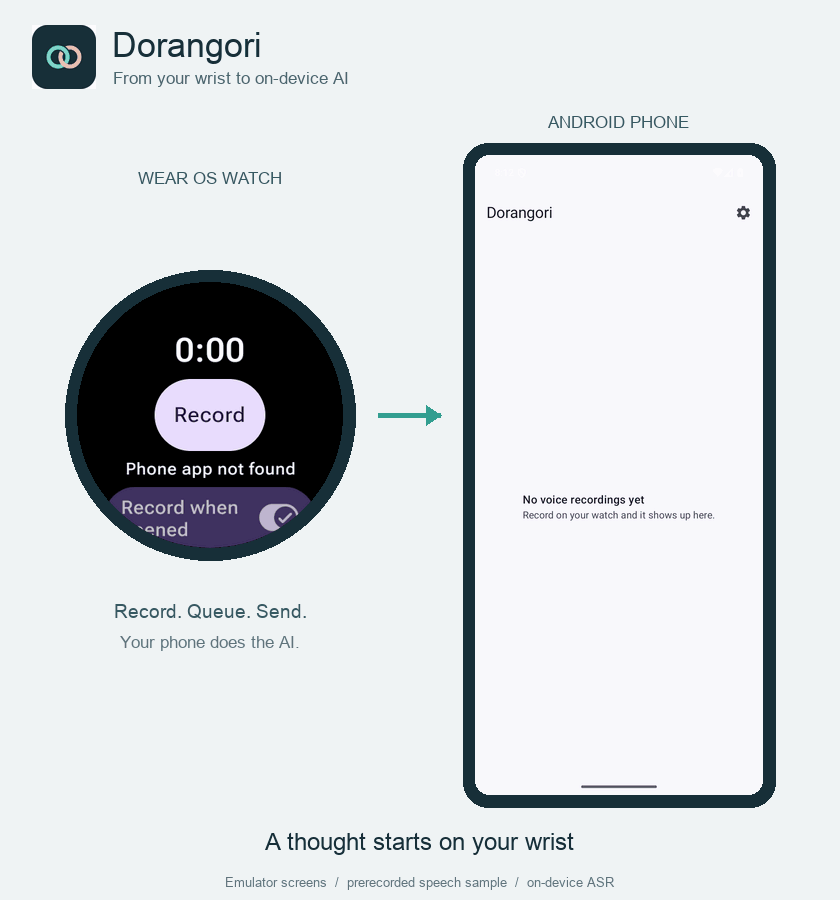

# Dorangori / 도란고리

**English** | [한국어](README.ko.md)

Your watch captures a thought; your phone turns it into something useful. **Dorangori** connects Wear OS and Android for on-device AI: record on your wrist, transcribe locally with [OndolSaem](https://github.com/sonanjip/ondolsaem), copy the text, ask [Malbotdari](https://github.com/sonanjip/malbotdari), or save the audio and transcript together in [Jogakbo](https://github.com/sonanjip/jogakbo).

<p></p>

*Actual watch and phone emulator screens, composed side by side. A prerecorded speech sample is used for the emulator microphone; transfer, transcription and note actions run locally in the apps.*

## Features

| Feature | What happens |
|---|---|
| Record on the watch | One screen button starts/stops recording; a watch button assigned to open Dorangori can launch the app. Home/Back are not intercepted. |
| Send when connected | Completed recordings wait on the watch while disconnected, then transfer when the paired phone reconnects. The watch copy is removed after the phone confirms receipt. |
| On-device transcription | OndolSaem recognizes speech on the phone. Choose right away, a daily time, when idle, or only on request. |
| Recognition language | Automatic detection, device language, Korean, English, Japanese, Mandarin, Cantonese; independent of the app display language. |
| Use the result | Copy; open a Malbotdari draft (not auto-sent); save one Jogakbo note holding the audio, transcript and timed lines. |
| Manage recordings | List and text previews, playback, detail actions, retry/re-transcribe, multi-select deletion and optional auto-delete after 7/30/90 days. |
| English / Korean | Both phone and watch UI are localized. On supported phones, choose the app display language in Android settings. |

The core workflow has been checked on paired emulators and tried on a Galaxy phone/watch. Hardware-button mapping and Samsung background restrictions depend on the device; see [verification notes and limits](docs/roadmap.md).

## Install

Download both APKs from [Dorangori Releases](https://github.com/sonanjip/dorangori/releases):

- **Dorangori-Phone-0.2.0.apk** — Android 10+ phone with Google Play services.
- **Dorangori-Wear-0.2.0.apk** — Wear OS 3+ watch, paired to that phone. Both Dorangori APKs must have the same signing certificate.

Install [OndolSaem 0.9.0+](https://github.com/sonanjip/ondolsaem/releases) on the phone and download SenseVoice from its Models tab. Optional: [Jogakbo 0.7.0+](https://github.com/sonanjip/jogakbo/releases) for audio+transcript notes, and [Malbotdari](https://github.com/sonanjip/malbotdari/releases) for questions. The release APKs share a signing key, so their local service connections need no extra approval.

Phone APKs can be downloaded and opened with a file manager. On the watch, enable Developer options → ADB debugging / Wireless debugging and use Wi-Fi ADB from a computer on the same network:

```bash
adb pair WATCH_IP:PAIRING_PORT    # "Pair new device" screen: enter its six-digit code
adb connect WATCH_IP:CONNECT_PORT # main Wireless debugging screen: a different port
adb -s WATCH_IP:CONNECT_PORT install -r Dorangori-Wear-0.2.0.apk
```

Keep the pairing-code screen open until pairing finishes. Samsung hardware continues to use **Galaxy Wearable** for the phone/watch pairing; the Pixel Watch companion described in the development guide is for the emulator. Turn wireless debugging off after installation if desired; ordinary recording transfers do not use ADB. Installing release APKs over locally signed debug builds may require uninstalling those builds first; keep/export recordings you need before doing so.

## About the name

**도란고리 (Dorangori)** joins **도란**, from *도란도란* — talking quietly and companionably — with **고리**, a ring or connecting link. A thought shared with your wrist travels through that link to your phone and its AI tools. The teal and apricot interwoven rings represent those two devices working together.

The name deliberately goes beyond a voice recorder: Dorangori is the place for future on-device AI features that need a phone/watch pair. It belongs alongside OndolSaem, Nunsori, Jogakbo and Malbotdari in [Sonanjip](https://github.com/sonanjip).

[User guide](docs/user-guide.md) · [Development / demo capture](docs/development.md) · [Architecture](docs/architecture.md) · [Privacy](docs/privacy.md) · [Roadmap](docs/roadmap.md)

Apache-2.0; see [LICENSE](LICENSE) and [third-party notices](THIRD_PARTY_NOTICES.md).
